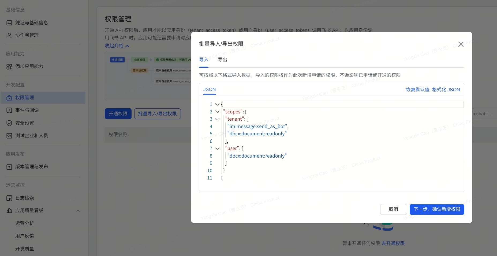

# larksync

这是一个用来同步飞书表格的项目，大多数项目的非技术人员在使用飞书在线表格进行管理的时候经常会出现大量数据需要人工核对，可能又需要去重，于是添加新的表变的非常麻烦，而整理好的csv中如果出现重复的数据，直接复制的话就gameover，当然会有用豆包更新表格的声音，如果你使用豆包更新表格，那我不要和你说话。

对于技术人员来讲，在pipeline搭建好之后发现跑脚本前需要拉取在线表格更新后的信息，需要折返到对应表格，下载，另存为csv，大概率还会出现XXXX表(1),XXXX表(2),然后就需要在修改脚本路径和重命名表格这两个愚蠢选项中选择一项，诸如此类，larksync是为了方便复用诞生的。

## 更新规则

GUI 和 Python 代码使用同一套规则。

- 补空的格子默认写入。
- 不一致的格子默认不写入。人工确认后，才可以写入。
- 新增的行由调用方决定是否写入。GUI 默认不勾选新增的行。
- 本地文件中为空的格子不参与比较。larksync 不清空在线表的值。
- larksync 不删除在线表的行。撤销时，只删除本次写入新增的行。
- 写入前，larksync 重新读取需要的行。预览后有人修改过这些格子时，写入就终止。

## 前提!!

1. 创建一个飞书自建应用（企业自建应用）:https://open.feishu.cn/?lang=zh-CN
2.“权限管理”中为应用开通以下权限(重要权限是需要企业审核才能开通的，以下皆为免审权限，可放心开通)：
```json
{
  "scopes": {
    "tenant": [
      "aily:knowledge:read",
      "base:record:retrieve",
      "bitable:app",
      "bitable:app:readonly",
      "docs:document.media:download",
      "drive:drive.metadata:readonly",
      "drive:drive:version",
      "drive:drive:version:readonly",
      "im:message",
      "im:message.group_at_msg.include_bot:readonly",
      "im:message.group_at_msg:readonly",
      "im:message.p2p_msg:readonly",
      "im:message.pins:read",
      "im:message.reactions:read",
      "im:message:readonly",
      "im:message:recall",
      "im:message:send_as_bot",
      "im:message:update",
      "im:resource",
      "sheets:spreadsheet",
      "sheets:spreadsheet.meta:read",
      "sheets:spreadsheet.meta:write_only",
      "sheets:spreadsheet:create",
      "sheets:spreadsheet:read",
      "sheets:spreadsheet:readonly",
      "sheets:spreadsheet:write_only",
      "wiki:wiki",
      "wiki:wiki:readonly"
    ],
    "user": [
      "aily:knowledge:read",
      "base:record:retrieve",
      "bitable:app",
      "bitable:app:readonly",
      "sheets:spreadsheet",
      "sheets:spreadsheet.meta:read",
      "sheets:spreadsheet.meta:write_only",
      "sheets:spreadsheet:create",
      "sheets:spreadsheet:read",
      "sheets:spreadsheet:readonly",
      "sheets:spreadsheet:write_only",
      "wiki:wiki",
      "wiki:wiki:readonly"
    ]
  }
}
```

3. 在应用的“安全设置”重定向 URL 中添加 `http://localhost:8888/callback`。

4. 创建并发布应用版本。
说明：权限修改并发布后，生效可以有几分钟的延迟;每个人必须使用自己的飞书应用,不同的人对在线表的权限不同。

## GUI 使用

### 首次配置


1. 可在https://github.com/libcyz/larksync/releases 下载最新的包,启动 larksync。结果：弹出「飞书应用与登录」窗口。
2. 填写「App ID」和「App Secret」。
3. 单击「保存并登录」。结果：浏览器打开飞书授权页。
4. 在 180 秒内单击「授权」。结果：窗口右上角显示你的飞书用户名。

登录状态保存在本机。下次启动时，不需要再登录。

## 术语

- **主键**：用来匹配行的字段。本地文件的行和在线表的行，主键值相同时视为同一行。
- **联合主键**：多个字段一起作为主键。一个字段的值有重复时，使用联合主键。
- **补空**：在线表的格子为空，本地文件有值。
- **未匹配**：在线表有这一行，本地文件没有这一行。

### 用本地文件更新在线表

1. 在左侧列表中选择一张在线表。结果：顶部显示表头的前 8 个字段。
2. 把本地文件拖入虚线框。也可以单击虚线框，选择本地文件。
3. 在「列对应」中检查每一个 CSV 列对应的字段。同名的列自动对应。
4. 勾选「主键」。一个字段的值有重复时，勾选多个字段。
5. 勾选「更新」中要写入的列。表头的「更新」复选框可以全选。
6. 单击「生成预览」。结果：显示「补空」「不一致」「新增」「未匹配」4 个页签。
7. 在「不一致」中核对每一个格子。只勾选确认要覆盖的格子。
8. 在「新增」中勾选确认要增加的行。
9. 单击「写入飞书」。结果：弹出确认框。
10. 单击「写入」。结果：显示「已写入飞书」。

列对应和主键保存在表格配置中。下次拖入同样格式的本地文件时，自动恢复。


### 其他操作

- 单击「刷新」：重新读取表头。在线表增加字段后，必须刷新。
- 单击「移除」：删除本机的表格配置。飞书上的在线表和写入记录不变。
- 单击右上角的用户名：修改 App ID 或 App Secret，或退出登录。

### 注意！！
	如果你的windows安全中心开着（一般默认都会开着），windows可能会把这个组件标记成不安全，选择“属性”--“解除锁定” 再重新解压即可。
	这是为了方便我自己代码调包复用所以创建的库，GUI则是为了方便大家审阅创建的，如果有任何建议可创立issue或者飞书联系我
	
开发者调用详见 [docs/python.md](https://github.com/libcyz/larksync/blob/main/docs/python.md)。
